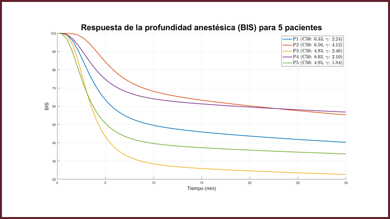

  

  

  <i>Connect with me</i>

   &nbsp;
   &nbsp;
   &nbsp;
  

---

<h3 align="center"><i>About me</i></h3>

I'm a Health Engineering student at the **University of Málaga**, combining the **Biomedical Engineering** and **Bioinformatics** tracks. I enjoy working at the intersection of medicine, data and software: turning clinical and biological data into models that are carefully validated and reproducible.

Before engineering, music took up most of my time. I studied classical piano at the conservatory from the age of 8 to 20, and the habit of daily practice and patience still shapes how I approach technical work today.

- 🎓 **Degree**: Health Engineering at UMA (Biomedical Engineering track completed, Bioinformatics track in progress; 8.81/10 average, 22 honours grades so far).
- 🔬 **Final degree project**: Predicting molecular alterations in lung cancer from H&E slides with pathology foundation models *(in progress)*.
- 🤝 **Mentoring**: Peer mentor for first-year students at the **ETSI Informática** since 2024.
- 📜 **Additional training**: NVIDIA DLI *Fundamentals of Accelerated Computing with Modern CUDA C++*.
- 🎹 **Music**: Professional Piano Degree, Extraordinary Award from the Junta de Andalucía, *matrícula de honor* and Santa Cecilia award.

---

<h3 align="center"><i>Featured projects</i></h3>

<table>
  <tr>
    <td width="50%" valign="top">
      
      
<b><a href="https://github.com/antoniodoa9/clasificacion-notas-oncologicas-pln">Oncology notes classification</a></b> 
      NLP on real Spanish clinical notes to detect patients with several neoplasms, checked with 30 seeds and nested cross-validation.

      

        
        
        
      

    </td>
    <td width="50%" valign="top">
      
      
<b><a href="https://github.com/antoniodoa9/cancer-mama-respuesta-neoadyuvante">Antibiotics and breast cancer response</a></b> 
      Data mining in R on a clinical cohort, deployed as <a href="https://antonio-sanchez-uma.shinyapps.io/biocalc/">BioCalc</a>, a Shiny app that predicts response to neoadjuvant chemotherapy.

      

        
        
        
      

    </td>
  </tr>
  <tr>
    <td width="50%" valign="top">
      
      
<b><a href="https://github.com/antoniodoa9/modelo-pkpd-propofol">PK-PD model of propofol anaesthesia</a></b> 
      Three-compartment pharmacokinetic and pharmacodynamic model simulating anaesthesia depth across individual patients.

      

        
        
        
      

    </td>
    <td width="50%" valign="top">
      
      
<b><a href="https://github.com/antoniodoa9/ChronoHealthDB">ChronoHealthDB</a></b> 
      Health record database designed with privacy by design across relational, XML and NoSQL engines, benchmarked with indexing.

      

        
        
        
      

    </td>
  </tr>
</table>

<b>More projects (7)</b>

 

- **[RNA-seq of *Arabidopsis*: Ler vs C24](https://github.com/antoniodoa9/arabidopsis-rnaseq-ler-c24)**: full workflow from raw reads to differential expression with Galaxy, kallisto and limma-voom ([reports](https://antoniodoa9.github.io/arabidopsis-rnaseq-ler-c24/)).
- **[Dexamethasone functional analysis](https://github.com/antoniodoa9/dexametasona-analisis-funcional)**: ORA versus GSEA on MSigDB Hallmark gene sets.
- **[Diabetes risk screening](https://github.com/antoniodoa9/diabetes-riesgo-ml)**: machine learning on the CDC BRFSS 2015 survey (ROC-AUC 0.83, recall 0.77).
- **[RAG over clinical guidelines](https://github.com/antoniodoa9/pab-proyecto)**: local LLM that answers from a clinical guideline and cites its pages.
- **[Aortic dissection network analysis](https://github.com/antoniodoa9/project_template)**: systems biology group project with STRING, igraph and Louvain *(in progress)*.
- **[MindVibe](https://github.com/antoniodoa9/mindvibe)**: EEG headset concept taken through the whole software engineering lifecycle, with a Spring Boot prototype and a [website](https://antoniodoa9.github.io/mindvibe/).
- **[HealthCalc](https://github.com/antoniodoa9/healthcalc_ISAgrupo03-Antonio)**: health calculator in Java built with testing, BDD, design patterns and refactoring.

Most repositories are documented in Spanish, with a short English summary at the top.

---

<h3 align="center"><i>Tools I've used during the degree</i></h3>

   
  

| Area | Tools |
|---|---|
| Data science and AI | scikit-learn, pandas, spaCy, NLTK, LangChain, ChromaDB, Ollama, Jupyter, RStudio, Quarto, Shiny |
| Bioinformatics | Galaxy, Bioconductor (edgeR, limma, clusterProfiler, STRINGdb), gseapy, rentrez, Sanger sequencing data, single-cell data (AnnData) |
| Biomedical engineering | MATLAB and Simulink, Modelica, LTspice, KiCad (PCB design), mbed microcontrollers with Bluetooth Low Energy, AutoCAD, medical image processing (DICOM) |
| Databases | Oracle SQL and PL/SQL, MySQL, SQL Server, MongoDB, XML and XQuery (eXist-db), HL7 |
| Software engineering | Spring Boot, Maven, JUnit, Cucumber, C# and .NET, Visual Paradigm (UML), draw.io, GanttProject, Docker, Git |
| Low level and GPU | MIPS assembly (WinMIPS64), CUDA C++ |
