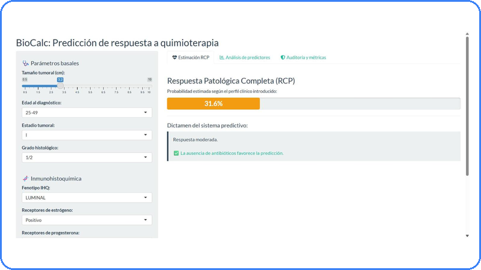
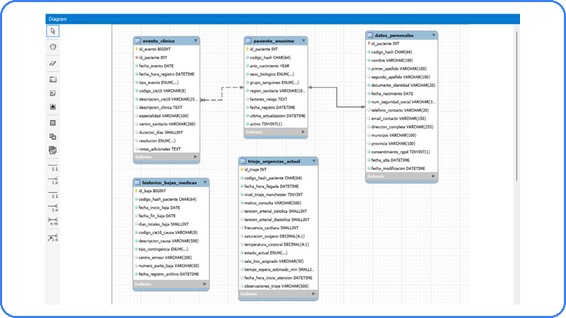

<h1 align="center">Hi, I'm Antonio Sánchez Doña 👋</h1>

  

   &nbsp;
   &nbsp;
   &nbsp;
  

---

<h3 align="center"><i>About me</i></h3>

I'm a Biomedical Engineering and Bioinformatics student at the **University of Málaga**. I enjoy the problems where medicine, data and code meet: turning clinical data into models that a doctor could actually trust, and checking every result twice before believing it.

Before engineering there was music. I spent twelve years at the conservatory, from the age of 8 to 20, and won the **Extraordinary Award in piano from the Junta de Andalucía**. Those years taught me the patience and discipline I now try to bring to every project.

  🎓 Health Engineering at UMA: <b>Biomedical Engineering</b> track completed, <b>Bioinformatics</b> track in progress 
  📊 Average grade <b>8.81/10</b>, with <b>22 honours grades</b> (<i>matrícula de honor</i>) so far 
  🔬 Final degree project: <b>predicting molecular alterations in lung cancer from H&E images</b> with pathology foundation models (in progress) 
  🤝 Mentor for new students at the <b>ETSI Informática</b> since 2024 
  📜 NVIDIA DLI certificate: <b>Fundamentals of Accelerated Computing with Modern CUDA C++</b> 
  🎹 Pianist: Professional Piano Degree, Extraordinary Award, <i>matrícula de honor</i> and Santa Cecilia award

---

<h3 align="center"><i>Featured projects</i></h3>

<table>
  <tr>
    <td width="50%" valign="top">
      
      
<b><a href="https://github.com/antoniodoa9/clasificacion-notas-oncologicas-pln">Oncology notes classification</a></b> 
      NLP on real Spanish clinical notes to detect patients with several neoplasms. AUC from 0.733 to 0.827, checked with 30 seeds and nested cross-validation.

    </td>
    <td width="50%" valign="top">
      
      
<b><a href="https://github.com/antoniodoa9/cancer-mama-respuesta-neoadyuvante">Antibiotics and breast cancer response</a></b> 
      Data mining in R on a clinical cohort, ending in <a href="https://antonio-sanchez-uma.shinyapps.io/biocalc/">BioCalc</a>, a Shiny app that predicts the response to chemotherapy.

    </td>
  </tr>
  <tr>
    <td width="50%" valign="top">
      
      
<b><a href="https://github.com/antoniodoa9/modelo-pkpd-propofol">PK-PD model of propofol anaesthesia</a></b> 
      Three-compartment model in MATLAB and Simulink that simulates how deep each patient's anaesthesia goes.

    </td>
    <td width="50%" valign="top">
      
      
<b><a href="https://github.com/antoniodoa9/ChronoHealthDB">ChronoHealthDB</a></b> 
      Health record database with privacy by design in MySQL, XML and MongoDB. Indexing made the patient history query 62 times faster.

    </td>
  </tr>
</table>

<b>More projects</b>

 

- **[RNA-seq of *Arabidopsis*: Ler vs C24](https://github.com/antoniodoa9/arabidopsis-rnaseq-ler-c24)**: full workflow from raw reads to differential expression with Galaxy, kallisto and limma-voom ([reports](https://antoniodoa9.github.io/arabidopsis-rnaseq-ler-c24/)).
- **[Dexamethasone functional analysis](https://github.com/antoniodoa9/dexametasona-analisis-funcional)**: ORA versus GSEA on MSigDB Hallmark gene sets.
- **[Diabetes risk screening](https://github.com/antoniodoa9/diabetes-riesgo-ml)**: machine learning on the CDC BRFSS 2015 survey (ROC-AUC 0.83, recall 0.77).
- **[RAG over clinical guidelines](https://github.com/antoniodoa9/pab-proyecto)**: local LLM that answers from a clinical guideline and cites its pages.
- **[Aortic dissection network analysis](https://github.com/antoniodoa9/project_template)**: systems biology group project with STRING, igraph and Louvain (in progress).
- **[MindVibe](https://github.com/antoniodoa9/mindvibe)**: EEG headset concept taken through the whole software engineering lifecycle, with a Spring Boot prototype and a [website](https://antoniodoa9.github.io/mindvibe/).
- **[HealthCalc](https://github.com/antoniodoa9/healthcalc_ISAgrupo03-Antonio)**: health calculator in Java built with testing, BDD, design patterns and refactoring.

Most repositories are documented in Spanish, with a short English summary at the top.

---

<h3 align="center"><i>Tools I've used during the degree</i></h3>

   
  

| Area | Tools |
|---|---|
| Data science and AI | scikit-learn, pandas, spaCy, NLTK, LangChain, ChromaDB, Ollama, Jupyter, RStudio, Quarto, Shiny |
| Bioinformatics | Galaxy, Bioconductor (edgeR, limma, clusterProfiler, STRINGdb), gseapy, rentrez, Sanger sequencing data, single-cell data (AnnData) |
| Biomedical engineering | MATLAB and Simulink, Modelica, LTspice, KiCad (PCB design), mbed microcontrollers with Bluetooth Low Energy, AutoCAD, medical image processing (DICOM) |
| Databases | Oracle SQL and PL/SQL, MySQL, SQL Server, MongoDB, XML and XQuery (eXist-db), HL7 |
| Software engineering | Spring Boot, Maven, JUnit, Cucumber, C# and .NET, Visual Paradigm (UML), draw.io, GanttProject, Docker, Git |
| Low level and GPU | MIPS assembly (WinMIPS64), CUDA C++ |
