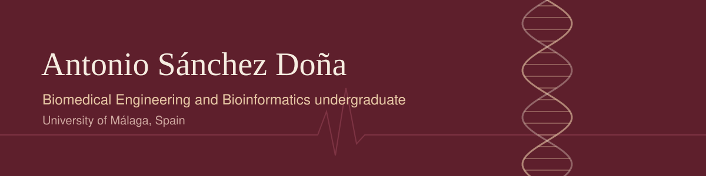

  

### Hi, I'm Antonio 👋

I'm a Biomedical Engineering and Bioinformatics undergraduate at the University of Málaga (Spain). I've completed the Biomedical Engineering track of the Health Engineering degree and I'm now finishing the Bioinformatics track too, so most of my work lives where medicine, data and software meet: clinical data analysis, machine learning, RNA-seq pipelines and models of physiological systems.

I like projects where the method can be checked: repeated cross-validation instead of a single split, simple baselines to compare against, and results that anyone can reproduce from the repository.

- 📊 Current average grade 8.81/10, with 22 honours grades (*matrícula de honor*) so far.
- 🔬 Working on my final degree project: predicting molecular alterations in lung adenocarcinoma from H&E histology images with pathology foundation models (2026-27, in progress).
- 🎓 Mentor in the ETSI Informática mentoring plan at UMA since 2024, helping new students with maths and with the degree.
- 📜 NVIDIA Deep Learning Institute certificate: *Fundamentals of Accelerated Computing with Modern CUDA C++*.
- 🎹 Outside engineering I'm a pianist: I studied at the conservatory from age 8 to 20, completed the Professional Piano Degree and the first year of the Higher Degree, and received the Extraordinary Award in piano from the Junta de Andalucía, an honours grade (*matrícula de honor*) and the Santa Cecilia award.

---

## 🧬 Projects

### Clinical data and machine learning

| Project | What it does | Tools |
|---|---|---|
| [**Oncology notes classification**](https://github.com/antoniodoa9/clasificacion-notas-oncologicas-pln) | Classifies real anonymised Spanish oncology notes (one neoplasm or several). The best model raises the AUC from 0.733 to 0.827, evaluated with 30-seed repeated cross-validation, permutation tests and nested cross-validation. | Python, spaCy, NLTK, scikit-learn |
| [**Antibiotics and breast cancer response**](https://github.com/antoniodoa9/cancer-mama-respuesta-neoadyuvante) | Studies whether antibiotic use during neoadjuvant chemotherapy affects pathological complete response, from multiple imputation to a predictive model deployed as a web app ([BioCalc](https://antonio-sanchez-uma.shinyapps.io/biocalc/)). | R, Quarto, Shiny |
| [**Diabetes risk screening**](https://github.com/antoniodoa9/diabetes-riesgo-ml) | Screening model on the CDC BRFSS 2015 survey with class imbalance handling, model comparison, interpretability and threshold analysis (ROC-AUC 0.83, recall 0.77). | Python, scikit-learn |
| [**RAG over clinical guidelines**](https://github.com/antoniodoa9/pab-proyecto) | Retrieval-Augmented Generation prototype over a clinical practice guideline with a local LLM, so answers cite the pages they come from and no data leaves the computer. | LangChain, ChromaDB, Ollama |

### Bioinformatics

| Project | What it does | Tools |
|---|---|---|
| [**RNA-seq of *Arabidopsis*: Ler vs C24**](https://github.com/antoniodoa9/arabidopsis-rnaseq-ler-c24) | Full RNA-seq workflow, from raw reads to differentially expressed genes and their functional interpretation ([reports](https://antoniodoa9.github.io/arabidopsis-rnaseq-ler-c24/)). | Galaxy, fastp, kallisto, edgeR, limma-voom, g:Profiler |
| [**Dexamethasone functional analysis**](https://github.com/antoniodoa9/dexametasona-analisis-funcional) | Functional interpretation of the dexamethasone response in airway smooth muscle cells, comparing ORA with GSEA preranked on the MSigDB Hallmark collection. | Python, gseapy |
| [**Aortic dissection network analysis**](https://github.com/antoniodoa9/project_template) | Systems biology group project: from an HPO phenotype to a STRING protein interaction network, its topology, Louvain modules and functional enrichment (in progress). | R, STRINGdb, igraph, clusterProfiler |

### Databases, software and modelling

| Project | What it does | Tools |
|---|---|---|
| [**ChronoHealthDB**](https://github.com/antoniodoa9/ChronoHealthDB) | Longitudinal health record database with privacy by design, where clinical and personal data live apart. Indexing made the patient history query 62 times faster. | MySQL, XML/XQuery, MongoDB, Python |
| [**PK-PD model of propofol anaesthesia**](https://github.com/antoniodoa9/modelo-pkpd-propofol) | Three-compartment pharmacokinetic model with effect site and Hill equation, simulating the BIS of different patients and dosing strategies. | MATLAB, Simulink |
| [**MindVibe**](https://github.com/antoniodoa9/mindvibe) | Concept of an EEG headset that adapts music to the user's emotional state, taken through the whole software engineering lifecycle, with a Spring Boot prototype and a [project website](https://antoniodoa9.github.io/mindvibe/). | Java, Spring Boot, UML |
| [**HealthCalc**](https://github.com/antoniodoa9/healthcalc_ISAgrupo03-Antonio) | Health metrics calculator built step by step with unit testing, BDD, a GUI with MVC, design patterns and refactoring. | Java, Maven, JUnit, Cucumber |

Most repositories are documented in Spanish, with a short English summary at the top.

---

## 🛠 Tools

**Languages**

**Data science and bioinformatics**

**Databases and software**

---

## 📬 Let's connect

