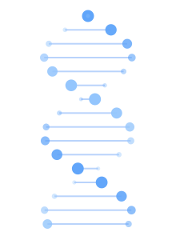
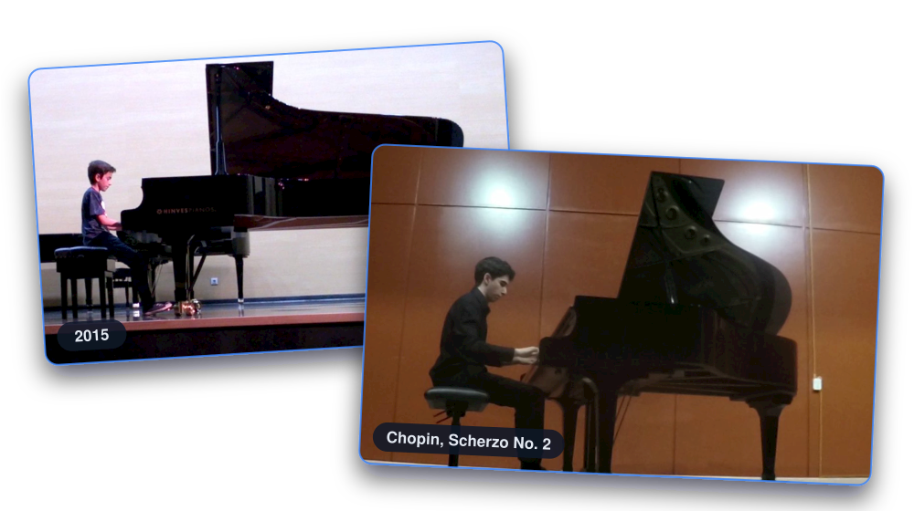
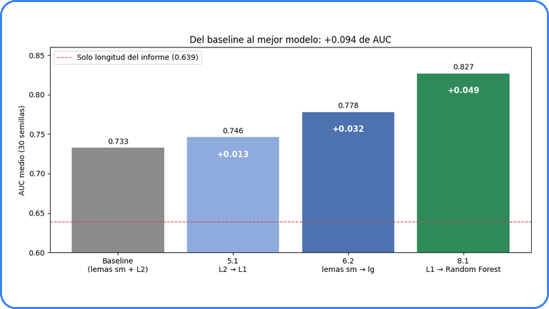
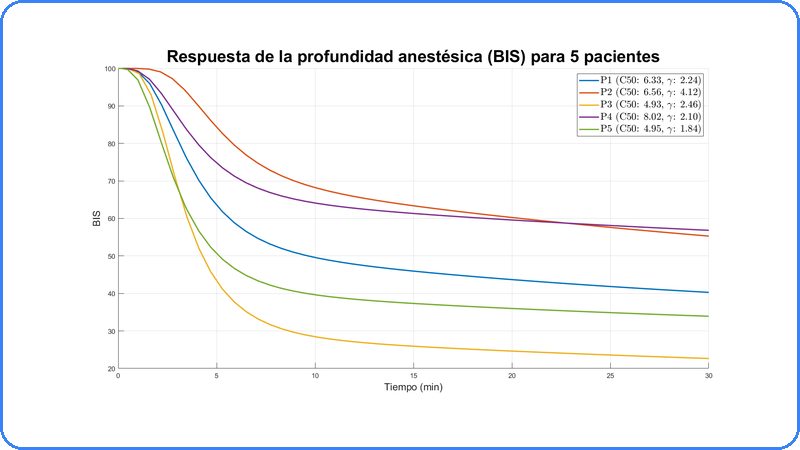

  

  

<h2 align="center">Connect with me</h2>

   &nbsp;
   &nbsp;
   &nbsp;
  

<h2 align="center">About me</h2>

I'm a Health Engineering student at the **University of Málaga**, combining the **Biomedical Engineering** and **Bioinformatics** tracks. I enjoy working at the intersection of medicine, data and software: turning clinical and biological data into models that are carefully validated and reproducible.

Before engineering, music took up most of my time. I studied classical piano at the conservatory from the age of 8 to 20, and the habit of daily practice and patience still shapes how I approach technical work today.

- 🎓 **Degree**: Health Engineering at UMA (Biomedical Engineering track completed, Bioinformatics track in progress; 8.81/10 average, 22 honours grades so far).
- 🔬 **Final degree project**: Predicting molecular alterations in lung cancer from H&E slides with pathology foundation models *(in progress)*.
- 🤝 **Mentoring**: Peer mentor for first-year students at the **ETSI Informática** since 2024.
- 📜 **Additional training**: NVIDIA DLI *Fundamentals of Accelerated Computing with Modern CUDA C++*.
- 🎹 **Music**: Professional Piano Degree, Extraordinary Award from the Junta de Andalucía, *matrícula de honor* and Santa Cecilia award.

 

   
  <i>On stage at the conservatory. Twelve years of daily practice before I wrote my first line of code.</i>

<h2 align="center">Featured projects</h2>

<table>
  <tr>
    <td width="50%" valign="top">
      
      
<b><a href="https://github.com/antoniodoa9/clasificacion-notas-oncologicas-pln">Oncology notes classification</a></b> 
      NLP on real Spanish clinical notes to detect patients with several neoplasms, checked with 30 seeds and nested cross-validation.

      

        
        
        
      

    </td>
    <td width="50%" valign="top">
      
      
<b><a href="https://github.com/antoniodoa9/cancer-mama-respuesta-neoadyuvante">Antibiotics and breast cancer response</a></b> 
      Data mining in R on a clinical cohort, deployed as <a href="https://antonio-sanchez-uma.shinyapps.io/biocalc/">BioCalc</a>, a Shiny app that predicts response to neoadjuvant chemotherapy.

      

        
        
        
      

    </td>
  </tr>
  <tr>
    <td width="50%" valign="top">
      
      
<b><a href="https://github.com/antoniodoa9/modelo-pkpd-propofol">PK-PD model of propofol anaesthesia</a></b> 
      Three-compartment pharmacokinetic and pharmacodynamic model simulating anaesthesia depth across individual patients.

      

        
        
        
      

    </td>
    <td width="50%" valign="top">
      
      
<b><a href="https://github.com/antoniodoa9/ChronoHealthDB">ChronoHealthDB</a></b> 
      Health record database designed with privacy by design across relational, XML and NoSQL engines, benchmarked with indexing.

      

        
        
        
      

    </td>
  </tr>
</table>

   
  <b><a href="https://antoniodoa9.github.io/mindvibe/">MindVibe website</a></b>: an EEG headset concept that adapts music to your emotional state, with a working demo of the admin panel

<b>More projects (7)</b>

 

- **[RNA-seq of *Arabidopsis*: Ler vs C24](https://github.com/antoniodoa9/arabidopsis-rnaseq-ler-c24)**: full workflow from raw reads to differential expression with Galaxy, kallisto and limma-voom ([reports](https://antoniodoa9.github.io/arabidopsis-rnaseq-ler-c24/)).
- **[Dexamethasone functional analysis](https://github.com/antoniodoa9/dexametasona-analisis-funcional)**: ORA versus GSEA on MSigDB Hallmark gene sets.
- **[Diabetes risk screening](https://github.com/antoniodoa9/diabetes-riesgo-ml)**: machine learning on the CDC BRFSS 2015 survey (ROC-AUC 0.83, recall 0.77).
- **[RAG over clinical guidelines](https://github.com/antoniodoa9/pab-proyecto)**: local LLM that answers from a clinical guideline and cites its pages.
- **[Aortic dissection network analysis](https://github.com/antoniodoa9/project_template)**: systems biology group project with STRING, igraph and Louvain *(in progress)*.
- **[MindVibe](https://github.com/antoniodoa9/mindvibe)**: EEG headset concept taken through the whole software engineering lifecycle, with a Spring Boot prototype and a [website](https://antoniodoa9.github.io/mindvibe/).
- **[HealthCalc](https://github.com/antoniodoa9/healthcalc_ISAgrupo03-Antonio)**: health calculator in Java built with testing, BDD, design patterns and refactoring.

Most repositories are documented in Spanish, with a short English summary at the top.

<h2 align="center">Tools I've used during the degree</h2>

   
  

  <b>🤖 Data science and AI</b> 
  
  
  
  
  
  
  
  
  
  
  

  <b>🧬 Bioinformatics</b> 
  
  
  
  
  
  
  
  
  
  

  <b>🫀 Biomedical engineering</b> 
  
  
  
  
  
  
  
  

  <b>🗄️ Databases</b> 
  
  
  
  
  
  
  

  <b>🛠️ Software engineering</b> 
  
  
  
  
  
  
  
  
  
  

  <b>⚡ Low level and GPU</b> 
  
  

Thanks for stopping by. Feel free to reach out if you want to talk about health data, bioinformatics or music 🎹

